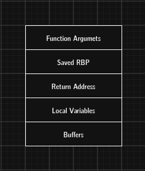

# ROP Chains

ROP stands for Return-Oriented Programming. A ROP chain is a sequence of existing instruction fragments, called gadgets, arranged so that execution flows from one gadget to the next by abusing the stack and the `RET` instruction.

This page is a conceptual overview of a security risk, not a chain-building exercise. The accompanying [vuln.c](vuln.c) is a bounded adjacent-data demonstration and does not provide saved-return-address control.

This technique is relevant when control-flow data is corrupted. It is included here to explain why non-executable data pages alone do not eliminate every control-flow risk.

## Why ROP exists

Modern mitigations such as DEP/NX prevent execution from writable memory, but do not by themselves prevent execution of code in pages that are already executable. Code-reuse risk depends on whether another flaw allows control of execution.

A ROP chain is not shellcode injection. It is code reuse.



## What is a gadget?

A gadget is a short instruction sequence that ends with a `RET` instruction.

Illustrative instruction fragments (not a chain):

```asm
pop rdi; ret
add rax, rdi; ret
mov [rdi], rsi; ret
```

Short instruction sequences are normal in compiled programs; their existence alone is not a vulnerability.

## Why ROP chains matter

In security reviews, code-reuse risk is assessed alongside control-flow integrity, memory safety, address randomization, and information disclosure. DEP/NX alone does not guarantee control-flow integrity.

## Why they are effective

Modern systems often block:

- executable stacks
- executable heaps
- writable code segments

But they still need to execute ordinary instructions from the program or libraries. ROP exploits this fact by chaining existing instructions in a controlled order.

## Defensive perspective

Prefer memory-safe languages or bounds-checked APIs, enable compiler and platform hardening, and fix the underlying memory-corruption defect. Stack canaries, PIE/ASLR, DEP/NX, and control-flow protections are defense in depth; none substitutes for eliminating the bug. A crash or overwritten value is not by itself proof that an attacker can control execution.

## Summary

ROP illustrates why non-executable data pages are only one layer of defense. Robust prevention combines memory-safe coding practices with compiler, operating-system, and hardware protections.
